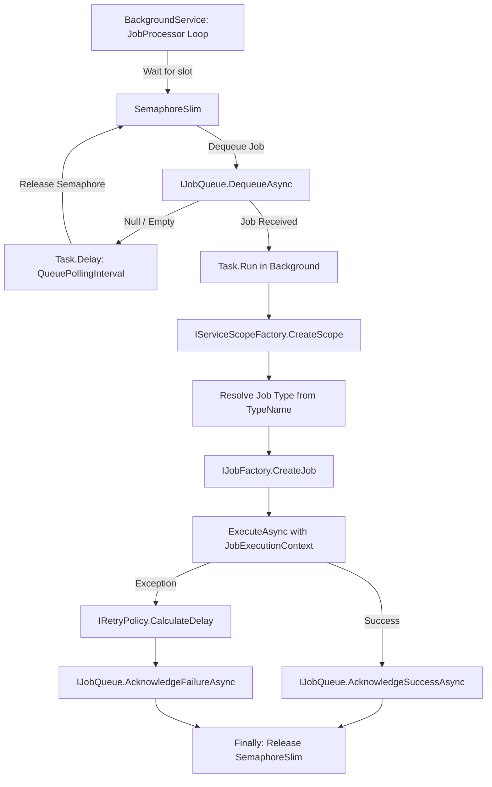

# PicoQueue Execution Pipeline Guide

This guide explains the architecture, responsibilities, and step-by-step implementation of the **Execution Pipeline** for `PicoQueue.Core`.

---

## 1. Pipeline Overview

The execution pipeline is the engine of PicoQueue. It runs as an ASP.NET Core / .NET `BackgroundService`, continuously polling storage for runnable jobs, instantiating them inside an isolated dependency injection scope, executing their logic, and recording the outcome (success or failure/retry).



---

## 2. Core Components to Implement

| Component | Role | Lifetime |
| :--- | :--- | :--- |
| **`IJobFactory`** | Defines contract for creating job handler instances using DI. | Singleton |
| **`DefaultJobFactory`** | Default implementation using `ActivatorUtilities.CreateInstance`. | Singleton |
| **`JobProcessor`** | Long-running hosted background worker orchestrating polling, throttling, execution, and acknowledgments. | Hosted Service (`IHostedService` / `BackgroundService`) |

---

## 3. Step-by-Step Implementation

### Step 1: Default Job Factory (`DefaultJobFactory.cs`)

#### Purpose:
When a job is dequeued, we have its `job.TypeName` (e.g. `"MyApp.Jobs.SendEmailJob, MyApp"`). We need to instantiate this type while injecting whatever dependencies its constructor requires (e.g., `IEmailSender`, `IConfiguration`, EF Core DbContexts).

#### Key Concept: `ActivatorUtilities` vs `serviceProvider.GetService`
- `serviceProvider.GetService(jobType)` only works if the user explicitly registered the job type itself into the DI container (`services.AddTransient<SendEmailJob>()`).
- `ActivatorUtilities.CreateInstance(serviceProvider, jobType)` allows the job type to resolve even if it wasn't pre-registered as a service, automatically resolving all constructor parameters from `serviceProvider`.

#### Implementation:
```csharp
namespace PicoQueue.Core.Execution;

using Microsoft.Extensions.DependencyInjection;

public class DefaultJobFactory : IJobFactory
{
    public object CreateJob(IServiceProvider serviceProvider, Type jobType)
    {
        ArgumentNullException.ThrowIfNull(serviceProvider);
        ArgumentNullException.ThrowIfNull(jobType);

        return ActivatorUtilities.CreateInstance(serviceProvider, jobType);
    }
}
```

---

### Step 2: Concurrency & Worker Identity in `JobProcessor`

#### 1. Concurrency Control with `SemaphoreSlim`
To avoid overwhelming the server and the database, concurrency must be throttled using `SemaphoreSlim`:
```csharp
private readonly SemaphoreSlim _concurrencySemaphore;

// Initialized with MaxConcurrentJobs from PicoQueueOptions:
_concurrencySemaphore = new SemaphoreSlim(options.Value.MaxConcurrentJobs, options.Value.MaxConcurrentJobs);
```

#### 2. Worker Identity
When dequeuing, SQLite / SQL storage locks rows using `WorkerId`. Every node or worker process should generate a unique identifier upon startup:
```csharp
private readonly string _workerId = $"worker-{Environment.MachineName}-{Guid.NewGuid():N}";
```

#### 3. Avoiding the "Captive Dependency" Bug
`JobProcessor` is a **Singleton** (`BackgroundService`). You **must not** inject scoped services (like `DbContext` or scoped repositories) directly into the `JobProcessor` constructor. Instead, inject `IServiceScopeFactory`, and create a new scope (`using var scope = _scopeFactory.CreateScope()`) for every single job execution.

---

### Step 3: The Main Polling Loop (`ExecuteAsync`)

The polling loop runs until application shutdown is requested via `stoppingToken`.

#### Algorithm:
1. **Acquire slot**: Wait for an available slot in `_concurrencySemaphore`.
2. **Dequeue**: Query storage for the next available job (`_jobQueue.DequeueAsync`).
3. **If empty**:
   - Release the semaphore slot immediately.
   - Wait for `options.QueuePollingInterval` before polling again.
4. **If job received**:
   - Dispatch the job execution to `Task.Run(...)` so the main polling loop can immediately continue to dequeue more jobs up to `MaxConcurrentJobs`.
   - Release the semaphore in the `finally` block of the dispatched task.

```csharp
protected override async Task ExecuteAsync(CancellationToken stoppingToken)
{
    while (!stoppingToken.IsCancellationRequested)
    {
        await _concurrencySemaphore.WaitAsync(stoppingToken);

        QueueJob? job = null;
        try
        {
            job = await _jobQueue.DequeueAsync(new DequeueJobDto
            {
                WorkerId = _workerId,
                Queue = "default"
            }, stoppingToken);
        }
        catch (OperationCanceledException) when (stoppingToken.IsCancellationRequested)
        {
            _concurrencySemaphore.Release();
            break;
        }
        catch (Exception ex)
        {
            _logger.LogError(ex, "Error while dequeuing next job.");
            _concurrencySemaphore.Release();
            await Task.Delay(_options.QueuePollingInterval, stoppingToken);
            continue;
        }

        if (job is null)
        {
            // No job ready; release slot and wait before polling again
            _concurrencySemaphore.Release();
            await Task.Delay(_options.QueuePollingInterval, stoppingToken);
            continue;
        }

        // Run job processing concurrently in background
        _ = ProcessJobWithConcurrencyAsync(job, stoppingToken);
    }
}
```

---

### Step 4: Processing the Job (`ProcessJobWithConcurrencyAsync`)

Make sure the concurrency semaphore is released when the task finishes, whether it succeeds or fails:

```csharp
private async Task ProcessJobWithConcurrencyAsync(QueueJob job, CancellationToken stoppingToken)
{
    try
    {
        await ProcessJobAsync(job, stoppingToken);
    }
    finally
    {
        _concurrencySemaphore.Release();
    }
}
```

---

### Step 5: Resolving & Executing the Job Instance (`ProcessJobAsync`)

This method handles scoping, job instantiation, execution, error handling, and acknowledgment.

#### Detailed Steps:

1. **Create Scope**:
   ```csharp
   using var scope = _scopeFactory.CreateScope();
   ```

2. **Resolve Runtime Type**:
   ```csharp
   var jobType = Type.GetType(job.TypeName);
   if (jobType is null)
   {
       throw new InvalidOperationException($"Could not resolve job type '{job.TypeName}'. Ensure assembly is loaded.");
   }
   ```

3. **Instantiate via Factory**:
   ```csharp
   var jobInstance = _jobFactory.CreateJob(scope.ServiceProvider, jobType);
   ```

4. **Prepare Context**:
   ```csharp
   var context = new JobExecutionContext
   {
       JobId = job.Id,
       Queue = job.Queue,
       AttemptNumber = job.Attempt + 1,
       MaxAttempts = job.MaxAttempts,
       CreatedAt = job.CreatedAt,
       ScheduledJobId = job.ScheduledJobId
   };
   ```

5. **Execute (`IJob` or `IJob<TArgs>`)**:
   - Check if `jobInstance` implements `IJob`:
     ```csharp
     if (jobInstance is IJob nonGenericJob)
     {
         await nonGenericJob.ExecuteAsync(context, stoppingToken);
     }
     ```
   - Check if it implements generic `IJob<TArgs>`:
     - Find the generic interface `IJob<>`.
     - Extract `TArgs` type.
     - Deserialize `job.PayloadJson` into `TArgs` using `System.Text.Json.JsonSerializer.Deserialize(job.PayloadJson, targetType)`.
     - Invoke `ExecuteAsync(args, context, stoppingToken)` (via dynamic or MethodInfo reflection).

6. **Acknowledge Success**:
   ```csharp
   await _jobQueue.AcknowledgeSuccessAsync(job.Id, stoppingToken);
   ```

---

### Step 6: Handling Failures & Retries

Wrap the execution inside a `try / catch (Exception ex)` block:

```csharp
catch (Exception ex)
{
    _logger.LogError(ex, "Execution failed for job {JobId} ({JobName})", job.Id, job.Name);

    var nextAttempt = job.Attempt + 1;
    DateTimeOffset? retryAt = null;

    if (nextAttempt < job.MaxAttempts)
    {
        // Calculate delay via retry policy
        var delay = _retryPolicy.CalculateDelay(nextAttempt, ex);
        retryAt = DateTimeOffset.UtcNow.Add(delay);
        _logger.LogWarning("Job {JobId} scheduled for retry #{Attempt} at {RetryAt}", job.Id, nextAttempt, retryAt);
    }
    else
    {
        _logger.LogError("Job {JobId} exceeded max attempts ({MaxAttempts}) and is permanently failed.", job.Id, job.MaxAttempts);
    }

    await _jobQueue.AcknowledgeFailureAsync(
        jobId: job.Id,
        errorMessage: ex.Message,
        errorDetail: ex.ToString(),
        retryAt: retryAt,
        ct: stoppingToken
    );
}
```

---

### Step 7: Heartbeat Management (Optional / Advanced)

For long-running jobs, you can run a background timer that periodically calls `_jobQueue.UpdateHeartbeatAsync(job.Id)` while `ExecuteAsync` is in progress. This informs other workers that this job is still alive and should not be considered orphaned.

---

## 4. Graceful Shutdown Best Practice

When the host signals shutdown:
1. Stop dequeuing new jobs immediately (`while (!stoppingToken.IsCancellationRequested)` exits).
2. Track running tasks using a thread-safe collection (e.g. `ConcurrentDictionary<Guid, Task>`).
3. In `StopAsync(CancellationToken cancellationToken)`, await `Task.WhenAll(activeTasks.Values)` so running jobs finish cleanly or respond to their cancellation tokens.

---

## 5. File Structure Summary

In `src/PicoQueue.Core/Execution/`:
```
Execution/
├── IJobFactory.cs           <- (Already created) Defines CreateJob abstraction
├── DefaultJobFactory.cs     <- Uses ActivatorUtilities.CreateInstance
└── JobProcessor.cs          <- BackgroundService polling, throttling, executing
```

---

## 6. Next Steps for You

1. Create and implement `DefaultJobFactory.cs` in `PicoQueue.Core/Execution/`.
2. Create and implement `JobProcessor.cs` in `PicoQueue.Core/Execution/`.
3. Verify compilation by running:
   ```bash
   dotnet build src/PicoQueue.Core/PicoQueue.Core.csproj
   ```
