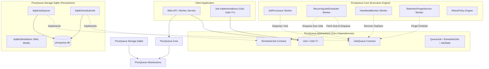
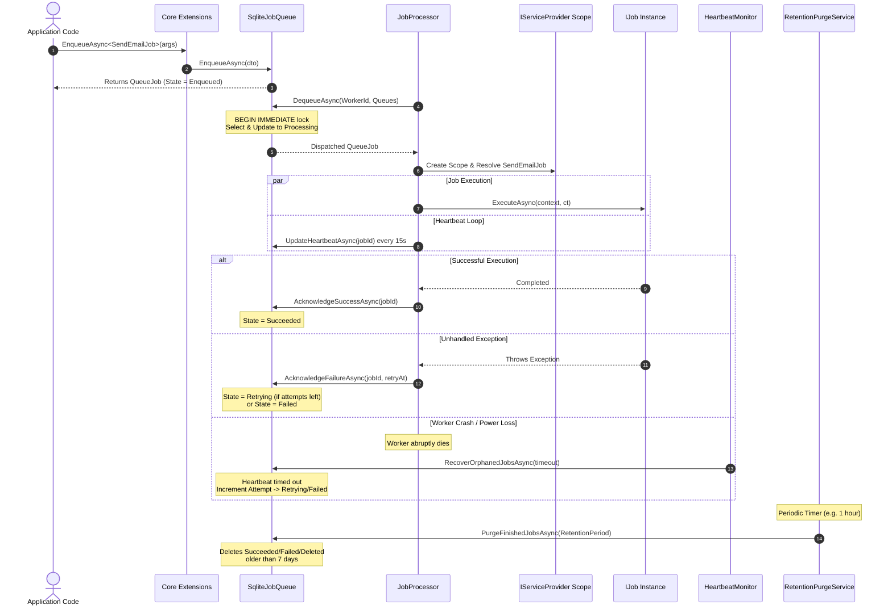

# PicoQueue — Architecture Overview & Integration Guide

Welcome to the architectural guide for **PicoQueue**, an embeddable, zero-infrastructure background job queue for .NET.

This document outlines the system architecture and serves as the master index connecting the modular packages of the PicoQueue ecosystem:

- 📑 **[Abstractions Documentation](file:///c:/Repos/PicoQueue/Docs/abstractions.md)**: Public contracts, models, DTOs, and attributes.
- ⚙️ **[Core Engine Documentation](file:///c:/Repos/PicoQueue/Docs/core.md)**: Concurrency workers, dispatchers, scheduling, and retry policies.
- 💾 **[SQLite Storage Documentation](file:///c:/Repos/PicoQueue/Docs/storage-sqlite.md)**: Raw ADO.NET persistence, schema, indexes, and locking transactions.

---

## 1. High-Level Component Architecture

PicoQueue follows a strictly layered, dependency-inverted design:



---

## 2. End-to-End Job Lifecycle



---

## 3. End-to-End Implementation Example

### A. Job Definition
Implement `IJob<TArgs>` and optionally annotate with `[Queue("name")]`:

```csharp
using PicoQueue.Abstractions.Attributes;
using PicoQueue.Abstractions.DTOs.Execution;
using PicoQueue.Abstractions.Interfaces;

namespace SampleApp.Jobs;

public record GenerateReportArgs(string ReportType, string UserEmail);

[Queue("reports")]
public class GenerateReportJob : IJob<GenerateReportArgs>
{
    private readonly ILogger<GenerateReportJob> _logger;

    public GenerateReportJob(ILogger<GenerateReportJob> logger)
    {
        _logger = logger;
    }

    public async Task ExecuteAsync(
        GenerateReportArgs args,
        JobExecutionContext context,
        CancellationToken cancellationToken)
    {
        _logger.LogInformation("Generating {Type} for {Email} (Attempt {Attempt}/{Max})",
            args.ReportType, args.UserEmail, context.AttemptNumber, context.MaxAttempts);

        // Do background work with cooperative cancellation
        await Task.Delay(2000, cancellationToken);
    }
}
```

---

### B. Startup Configuration (`Program.cs`)
Combine `AddPicoQueueCore` with `AddPicoQueueSqlite`:

```csharp
using PicoQueue.Core.Extensions;
using PicoQueue.Storage.Sqlite.Extensions;
using SampleApp.Jobs;

var builder = WebApplication.CreateBuilder(args);

// 1. Register Core Engine & Background Hosted Services
builder.Services.AddPicoQueueCore(options =>
{
    options.MaxConcurrentJobs = 8;
    options.QueuePollingInterval = TimeSpan.FromSeconds(2);
    options.RetentionPeriod = TimeSpan.FromDays(14); // Keep history for 14 days
});

// 2. Register SQLite Storage Backend
builder.Services.AddPicoQueueSqlite("Data Source=sample_queue.db;Cache=Default");

var app = builder.Build();
```

---

### C. Enqueueing & Scheduling from Endpoints
Inject `IJobQueue` and `IScheduleJob` wherever needed:

```csharp
// Fire-and-forget job
app.MapPost("/reports", async (IJobQueue queue, GenerateReportArgs req) =>
{
    Guid jobId = await queue.EnqueueAsync<GenerateReportJob, GenerateReportArgs>(req);
    return Results.Accepted($"/jobs/{jobId}", new { JobId = jobId });
});

// Delayed execution (runs 3 hours from now)
app.MapPost("/reports/delayed", async (IScheduleJob scheduler, GenerateReportArgs req) =>
{
    Guid scheduledId = await scheduler.ScheduleAsync<GenerateReportJob>(
        DateTimeOffset.UtcNow.AddHours(3),
        name: "Delayed 3h Report");

    return Results.Accepted($"/scheduled/{scheduledId}");
});

// Recurring Cron execution (runs every midnight UTC)
app.MapPost("/reports/recurring", async (IScheduleJob scheduler) =>
{
    Guid scheduledId = await scheduler.ScheduleAsync<GenerateReportJob>(
        cronExpression: "0 0 * * *",
        name: "Daily Midnight Report");

    return Results.Ok(new { ScheduledId = scheduledId });
});

app.Run();
```

---

## 4. Swapping Storage Backends

Because `PicoQueue.Core` only depends on `IJobQueue` and `IScheduleJob`, alternative storage engines (e.g., PostgreSQL or SQL Server) can be built without changing core engine code:

```csharp
// From SQLite:
builder.Services.AddPicoQueueSqlite(sqliteConnectionString);

// To PostgreSQL (Separate package):
// builder.Services.AddPicoQueuePostgres(pgConnectionString);
```

The application's job definitions, enqueue invocations, retry mechanics, concurrency throttling, and scheduling logic remain identical.
