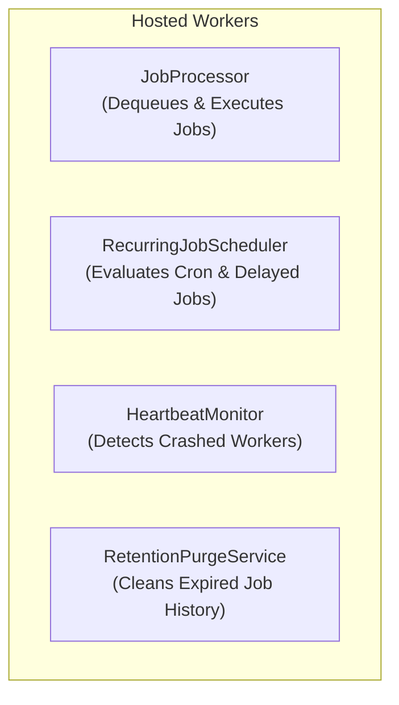

# PicoQueue.Core — Execution Engine & Services

`PicoQueue.Core` houses the runtime execution engine, background workers, scheduling dispatchers, retry policies, and DI setup. It interacts solely with the contracts in `PicoQueue.Abstractions`, making it completely storage-agnostic.

---

## 1. Background Hosted Workers

`PicoQueue.Core` registers four dedicated `IHostedService` background workers:



### `JobProcessor`
The primary dispatcher responsible for polling and executing jobs.
- **Concurrency Throttling**: Uses `SemaphoreSlim` initialized to `PicoQueueOptions.MaxConcurrentJobs` (defaults to `ProcessorCount * 2`).
- **Multi-Queue Routing**: Respects the configured `Queues` priority list in `PicoQueueOptions`. If empty, queries across all queues ordered by `Priority DESC, CreatedAt ASC`.
- **Heartbeat Loop**: Spawns an internal background loop (`RunHeartbeatLoopAsync`) that refreshes `HeartbeatAt` every `HeartBeatMonitorInterval / 2` while the job executes.
- **Cooperative Cancellation**: Links host shutdown tokens with execution tokens and supplies them to `IJob.ExecuteAsync`.
- **Scoped Activation**: Resolves job instances inside a dedicated `IServiceScope` via `IJobFactory`.

### `RecurringJobScheduler`
Translates due scheduled definitions into executable queue items.
- Evaluates `IScheduleJob.GetDueJobsAsync(now)` every `SchedulePollingInterval` (default: 15s).
- Translates due items into `QueueJob` entries via `IJobQueue.EnqueueAsync`, preserving `ScheduledJobId`.
- **Cron Jobs**: Parses `CronExpression` using `Cronos` and records `nextRunAt` via `IScheduleJob.RecordTriggerAsync`.
- **Delayed Jobs**: Detects non-recurring scheduled jobs (`IsRecurring = false`) and marks them disabled (`SetEnabledAsync(false)`) after the initial trigger.

### `HeartbeatMonitor`
Detects and recovers stuck or orphaned jobs left by crashed worker processes.
- Periodically runs at `HeartBeatMonitorInterval` (default: 30s).
- Calls `IJobQueue.RecoverOrphanedJobsAsync(timeout)`.
- Atomically increments the job attempt count:
  - If `Attempt + 1 >= MaxAttempts` -> transitions to `Failed`.
  - Otherwise -> transitions to `Retrying` and schedules immediate retry.

### `RetentionPurgeService`
Automates history cleanup for finished jobs (FR14).
- Periodically runs at `RetentionPurgeInterval` (default: 1 hour).
- Calls `IJobQueue.PurgeFinishedJobsAsync(RetentionPeriod)` (default retention: 7 days).
- Purges finished jobs in terminal states (`Succeeded`, `Failed`, `Deleted`, `Expired`).
- Can be disabled by setting `RetentionPurgeInterval <= TimeSpan.Zero`.

---

## 2. Execution Policies & Job Activation

### `IRetryPolicy` & `DefaultRetryPolicy`
Calculates backoff delays when a job throws an unhandled exception:

```csharp
public interface IRetryPolicy
{
    TimeSpan? CalculateNextRetryDelay(int currentAttempt, int maxAttempts, Exception ex);
}
```

The `DefaultRetryPolicy` uses **exponential backoff with randomized jitter**:
$$\text{delay} = 2^{\text{attempt}} \times \text{baseDelay} \pm \text{jitter}$$
- Caps at a maximum delay (default: 24 hours).
- Returns `null` when `currentAttempt >= maxAttempts`, indicating that no further retries should occur.

### `IJobFactory` & `DefaultJobFactory`
Activates job instances using the scoped `IServiceProvider`:
- Prefers `ActivatorUtilities.GetServiceOrCreateInstance` to support dependency injection within job constructors.

---

## 3. Configuration (`PicoQueueOptions`)

Configured during startup via `AddPicoQueueCore`:

```csharp
public sealed class PicoQueueOptions
{
    // Concurrency limit
    public int MaxConcurrentJobs { get; set; } = Environment.ProcessorCount * 2;

    // Polling intervals
    public TimeSpan QueuePollingInterval { get; set; } = TimeSpan.FromSeconds(2);
    public TimeSpan SchedulePollingInterval { get; set; } = TimeSpan.FromSeconds(15);
    public TimeSpan HeartBeatMonitorInterval { get; set; } = TimeSpan.FromSeconds(30);

    // Queue selection
    public string QueueName { get; set; } = "default";
    public string[] Queues { get; set; } = [];

    // History retention
    public TimeSpan RetentionPeriod { get; set; } = TimeSpan.FromDays(7);
    public TimeSpan RetentionPurgeInterval { get; set; } = TimeSpan.FromHours(1);
}
```

---

## 4. Fluent API Extensions

`PicoQueue.Core.Extensions` provides type-safe, generic enqueue and schedule extensions:

### Enqueueing
```csharp
// Fire-and-forget without args
Guid jobId = await jobQueue.EnqueueAsync<SendDailyDigestJob>();

// Strongly typed payload
Guid jobId = await jobQueue.EnqueueAsync<SendEmailJob, SendEmailArgs>(new SendEmailArgs
{
    To = "user@example.com",
    Subject = "Welcome!"
});
```

### Scheduling
```csharp
// Delayed execution (supports DateTimeOffset)
Guid scheduledId = await scheduleJob.ScheduleAsync<CleanupTempFilesJob>(
    DateTimeOffset.UtcNow.AddHours(4));

// Recurring cron execution
Guid scheduledId = await scheduleJob.ScheduleAsync<NightlySyncJob>(
    cronExpression: "0 2 * * *");
```
