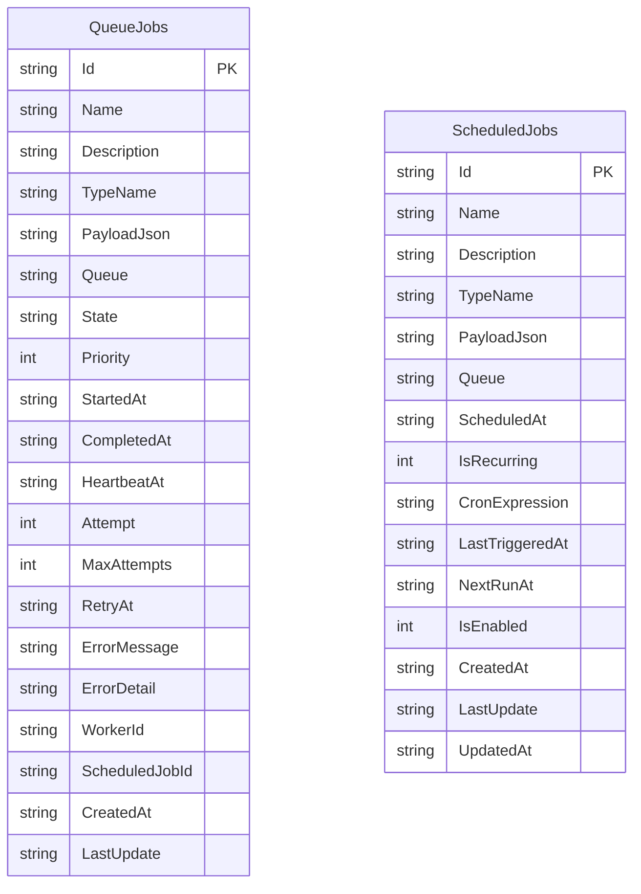

# PicoQueue.Storage.Sqlite — Reference Storage Implementation

`PicoQueue.Storage.Sqlite` is the reference storage implementation for PicoQueue. It implements `IJobQueue` and `IScheduleJob` using raw ADO.NET (`Microsoft.Data.Sqlite`) with **zero Object-Relational Mapping (ORM) dependencies** like Entity Framework Core.

---

## 1. Engine Philosophy & SQLite Configurations

PicoQueue uses SQLite as an embeddable, zero-infrastructure database. To ensure high concurrency, crash resilience, and multi-threaded safety, every connection applies the following PRAGMAs:

```sql
PRAGMA journal_mode = WAL;
PRAGMA synchronous = NORMAL;
PRAGMA busy_timeout = 5000;
PRAGMA foreign_keys = ON;
```

- **Write-Ahead Logging (WAL)**: Allows concurrent readers while a write transaction is occurring.
- **`busy_timeout = 5000`**: Automatically waits up to 5 seconds if another thread or process holds the database write lock, avoiding `SQLITE_BUSY` lock errors.
- **ISO 8601 Roundtrip Timestamps**: All timestamps (`DateTimeOffset`) are stored in ISO 8601 format (`"O"`: `yyyy-MM-ddTHH:mm:ss.fffffffzzz`), ensuring chronological string ordering and timezone preservation.

---

## 2. Database Schema

Schema initialization is completely automatic and idempotent on the first query via `SqliteDbInitializer`.



### Table: `QueueJobs`
Stores all enqueued, executing, retrying, and completed jobs.

### Table: `ScheduledJobs`
Stores delayed and recurring cron job definitions.

---

## 3. High-Performance Indexes

The schema creates filtered and composite indexes tuned for the core engine queries:

| Index Name | Columns / Filter | Purpose |
| :--- | :--- | :--- |
| `idx_queue_jobs_poll` | `(Queue, State, Priority DESC, CreatedAt ASC)` | Instant job polling and FIFO priority dequeueing. |
| `idx_queue_jobs_heartbeat` | `(State, HeartbeatAt ASC) WHERE State = 'Processing'` | High-speed detection of crashed workers by `HeartbeatMonitor`. |
| `idx_queue_jobs_purge` | `(State, LastUpdate ASC)` | High-speed cleanup passes by `RetentionPurgeService` across large datasets. |
| `idx_scheduled_jobs_due` | `(IsEnabled, NextRunAt ASC) WHERE IsEnabled = 1` | Instant resolution of due cron and delayed jobs by `RecurringJobScheduler`. |

---

## 4. Atomic Dequeue Locking (`IMMEDIATE` Transactions)

To prevent race conditions when multiple worker threads or processes poll the queue simultaneously, `DequeueAsync` uses an `IMMEDIATE` transaction:

```sql
BEGIN IMMEDIATE;

-- 1. Select highest priority eligible job
SELECT * FROM QueueJobs
WHERE (Queue = @Queue OR @Queue IS NULL)
  AND (
        State = 'Enqueued'
     OR (State = 'Retrying' AND RetryAt <= @Now)
  )
ORDER BY Priority DESC, CreatedAt ASC
LIMIT 1;

-- 2. Atomically lock to current worker
UPDATE QueueJobs
SET State = 'Processing',
    WorkerId = @WorkerId,
    StartedAt = @Now,
    HeartbeatAt = @Now,
    LastUpdate = @Now
WHERE Id = @SelectedId;

COMMIT;
```

If another worker is currently writing, the `busy_timeout` pragma waits transparently.

---

## 5. Automated Purging (`PurgeFinishedJobsAsync`)

Implements the database retention policy (FR14):

```sql
DELETE FROM QueueJobs
WHERE State IN ('Succeeded', 'Failed', 'Deleted', 'Expired')
  AND LastUpdate <= @Threshold;
```

- Safe against deleting active jobs (`Enqueued`, `Processing`, `Retrying`).
- Validates that the retention interval is non-negative (`olderThan >= TimeSpan.Zero`).

---

## 6. Dependency Injection Setup

Register SQLite storage in `Program.cs`:

```csharp
builder.Services.AddPicoQueueSqlite("Data Source=picoqueue.db;Cache=Default");
```

This registers:
- `ISqliteConnectionFactory`: Thread-safe connection factory.
- `SqliteDbInitializer`: Thread-safe schema initialization service.
- `IJobQueue` -> `SqliteJobQueue`
- `IScheduleJob` -> `SqliteScheduleJob`
